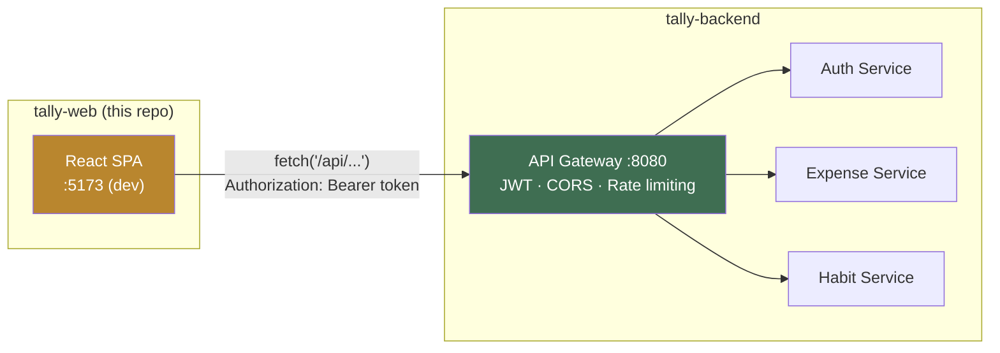
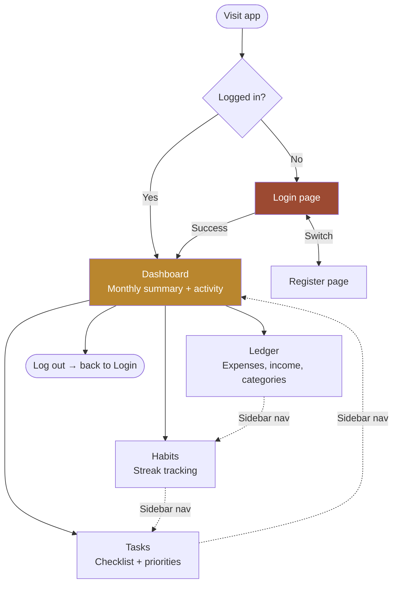
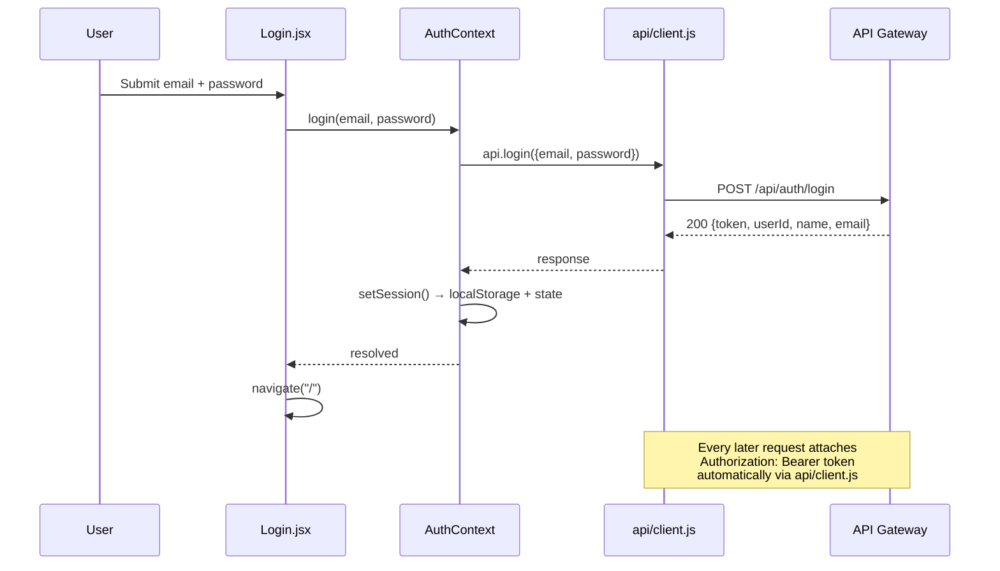

# Personal Tracker — Frontend

[](https://react.dev/)
[](https://vitejs.dev/)
[](https://reactrouter.com/)
[](#license)

A React (Vite) frontend for the **Tally** personal finance and habit-tracking platform, built on a microservices backend. Communicates exclusively with the API Gateway — never directly with individual backend services.

**Backend repository:** [tally-backend](https://github.com/Sidd-Tiwari/tally-backend)

---

## Design Concept

The app is built around a single idea: a **tally mark** is the oldest way to count anything, and this app counts two things — money and days. The entire visual identity grows from that one idea rather than a generic dashboard template:

- **Paper/ledger palette** — warm aged-paper background, ink-toned text, brass as the primary accent, forest-green for credits, rust for debits
- **Typography** — Fraunces (display), IBM Plex Sans (body), IBM Plex Mono (all numbers, tabular)
- **Signature element** — hand-tally-style SVG strokes (four verticals + one diagonal slash) used to visualize habit streaks — a real, at-a-glance count, not decoration

## Where This Fits



This app never talks to `auth-service`, `expense-service`, or `habit-service` directly — every request goes through the gateway, which is the only backend URL this codebase ever references (see `vite.config.js` for local dev, or `VITE_API_BASE` for production).

## App Navigation



Every page except Login/Register is wrapped in `ProtectedLayout`, which redirects to `/login` if there's no valid session — see `src/components/ProtectedLayout.jsx`.

## Authentication Flow



Session state lives in `AuthContext` (React Context), backed by `localStorage` so a refresh doesn't log the user out. Every subsequent API call goes through the single `api/client.js` wrapper, which attaches the token and normalizes error responses so pages just `try/catch` and show `err.message`.

## Features

- Secure authentication (JWT-based session handling)
- Monthly financial dashboard — income, expenses, net balance at a glance
- Full ledger — expense/income CRUD with custom categories
- Habit tracking with streak visualization
- Task management with priority levels and due dates
- Responsive layout, built mobile-first

## Tech Stack

| Layer | Technology |
|---|---|
| Framework | React 18 + Vite 5 |
| Routing | React Router |
| Styling | Custom CSS with design tokens (no framework dependency) |
| State | React Context (auth/session) |
| API layer | Fetch-based client with JWT attachment and error normalization |

## Prerequisites

- Node.js 18+
- The backend running locally or deployed — see [tally-backend](https://github.com/Sidd-Tiwari/tally-backend) — specifically the **API Gateway on port 8080**

## Getting Started

```bash
npm install
npm run dev
```

Runs on `http://localhost:5173`. The dev server proxies `/api/*` requests to `http://localhost:8080` (see `vite.config.js`), so no CORS configuration is needed locally.

## Building for Production

```bash
npm run build
```

Outputs static files to `dist/`. Serve these with any static host (nginx, Vercel, Netlify, etc.). Since there's no dev proxy in production, choose one:

1. Put a reverse proxy in front that forwards `/api/*` to your deployed gateway, or
2. Set an environment variable (e.g. `VITE_API_BASE`) and update `src/api/client.js` to use an absolute URL instead of the relative `/api` path.

## Project Structure

```
src/
├── api/client.js            # Fetch wrapper — attaches JWT, normalizes errors
├── context/AuthContext.jsx  # Session state (login/register/logout)
├── components/
│   ├── TallyMarks.jsx       # The signature streak visual
│   ├── Sidebar.jsx          # Passbook-style navigation
│   ├── StatCard.jsx
│   └── ProtectedLayout.jsx  # Redirects to /login if not authenticated
├── pages/
│   ├── Login.jsx / Register.jsx
│   ├── Dashboard.jsx        # Monthly summary + recent activity
│   ├── Ledger.jsx           # Expenses/income CRUD + category management
│   ├── Habits.jsx           # Habit CRUD + streak tracking
│   └── Tasks.jsx            # Task CRUD + checklist
└── styles/
    ├── tokens.css           # Design tokens (colors, type, spacing)
    └── global.css           # Base styles, shared card/button/form classes
```

## Roadmap

- [ ] Test suite (unit + integration)
- [ ] Spending-by-category visualization on the dashboard
- [ ] Dark mode
- [ ] PWA support for offline access

## Security Notes

- Auth tokens are stored in `localStorage`, which is standard for local development. For production deployments handling sensitive financial data, httpOnly cookies are recommended to reduce XSS exposure.
- Currency is formatted for the `en-IN` locale (INR) — update `src/utils/format.js` for other locales/currencies.

## License

This project is licensed under the MIT License.

---

## Author

**Siddharth Tiwari**

- Portfolio: [siddharth-tiwari.vercel.app](https://siddharth-tiwari.vercel.app/)
- LinkedIn: [in/siddharth-tiwari-394451271](https://www.linkedin.com/in/siddharth-tiwari-394451271/)
- GitHub: [@Sidd-Tiwari](https://github.com/Sidd-Tiwari)
- LeetCode: [Sidd-Tiwari](https://leetcode.com/u/Sidd-Tiwari/)

If you found this project useful or interesting, consider giving it a ⭐ on GitHub.
